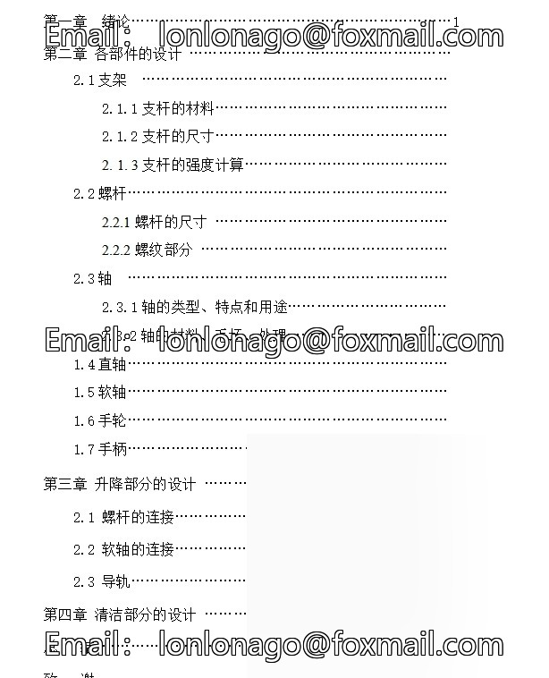
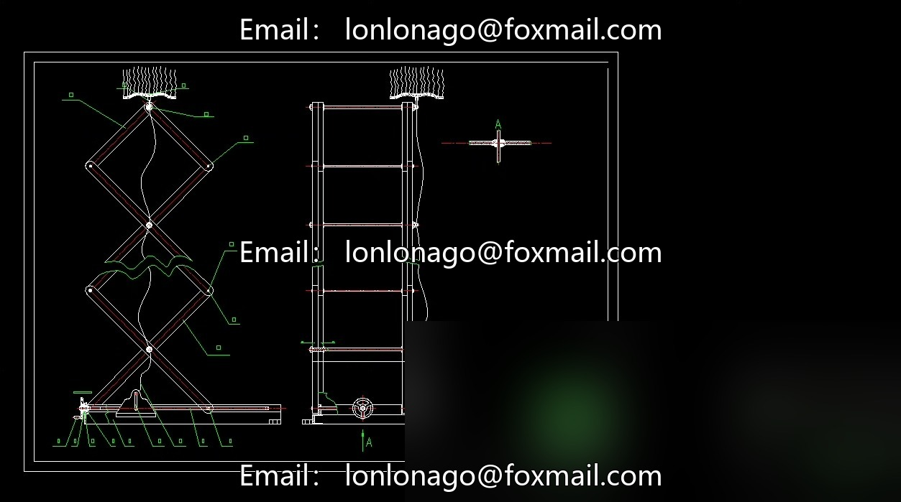
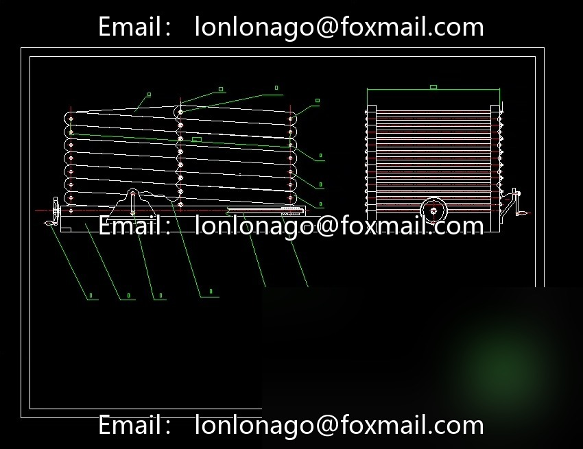

# Design of the light street cleaning device; Design of the light street cleaning device drawing; Design of the light street cleaning device

## Body

Clean street light installation design; design diagram of clean street light installation; design CAD diagram of clean street light installation.
65. Includes assembly diagrams, part diagrams, and design annotations.

The design diagram and CAD figure describe the overall design of the clean street light device, covering parts design, support, screw, axis, soft axis, guide and cleaning components.

<!-- AI_ENRICHED -->

## Images

## Payment

Here is a pay link on Stripe ( https://buy.stripe.com/3cs8yP7sY87d0vu9AB ). Please contact me lonlonago@foxmail.com after funding $89, and I will send you a complete data files , thank you!

